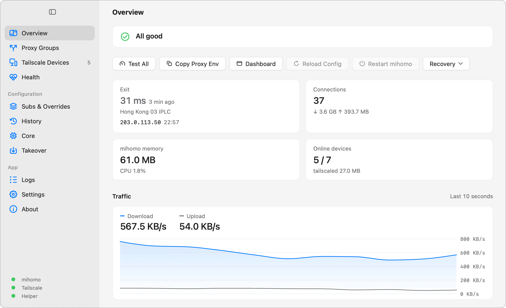
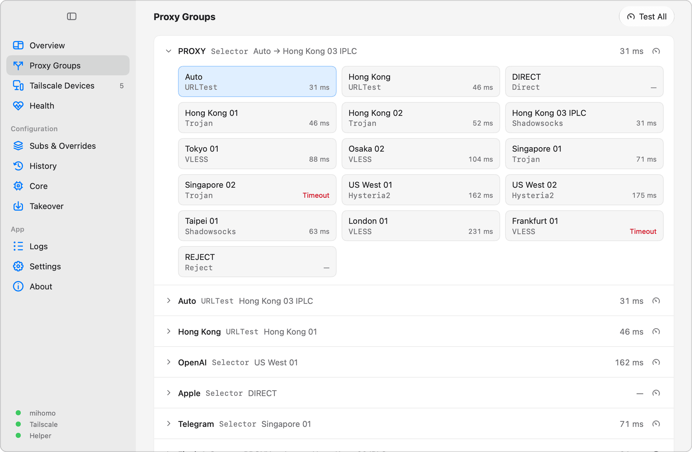
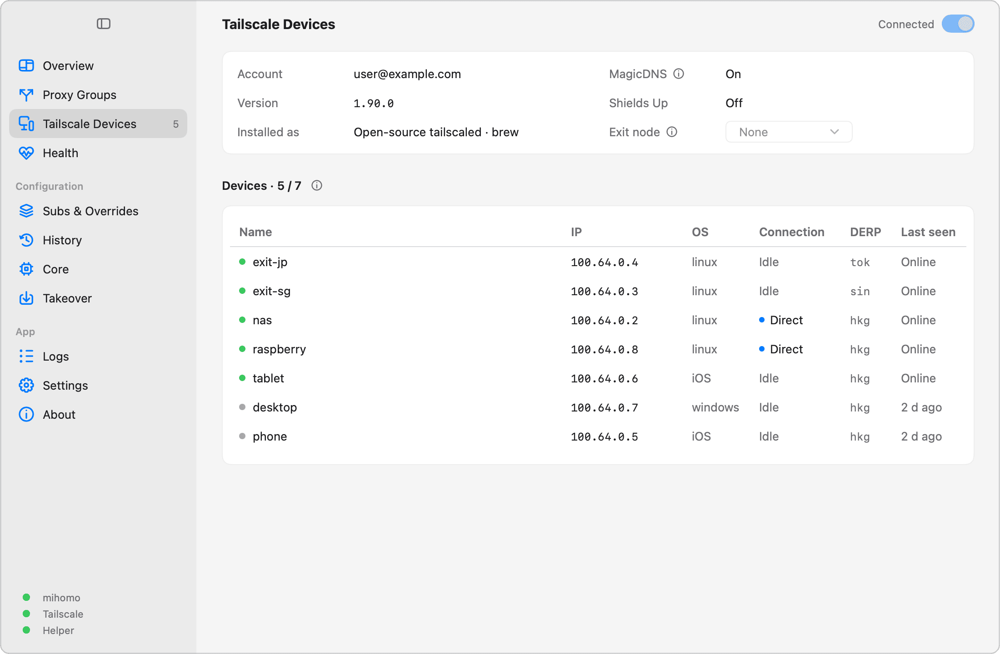
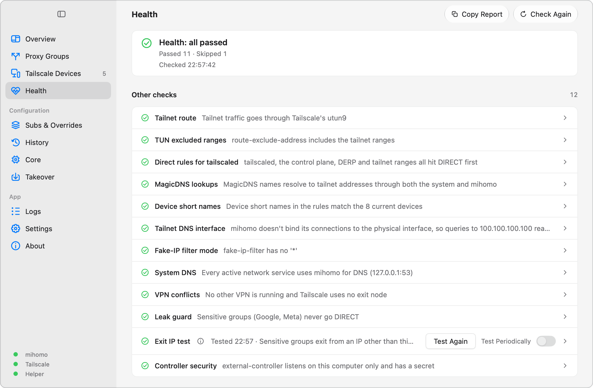
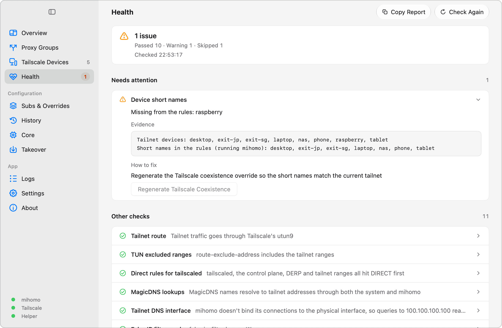
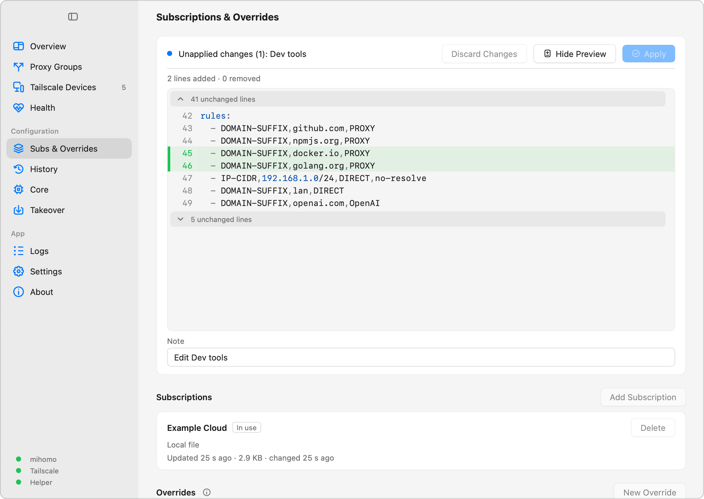
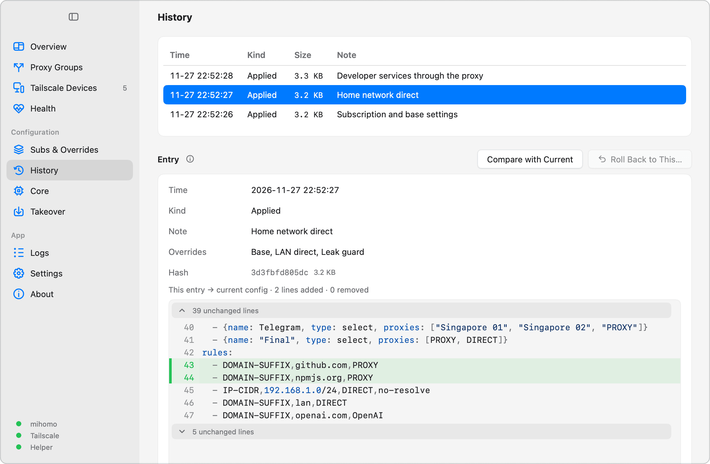
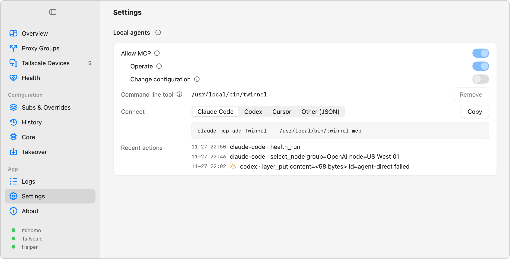
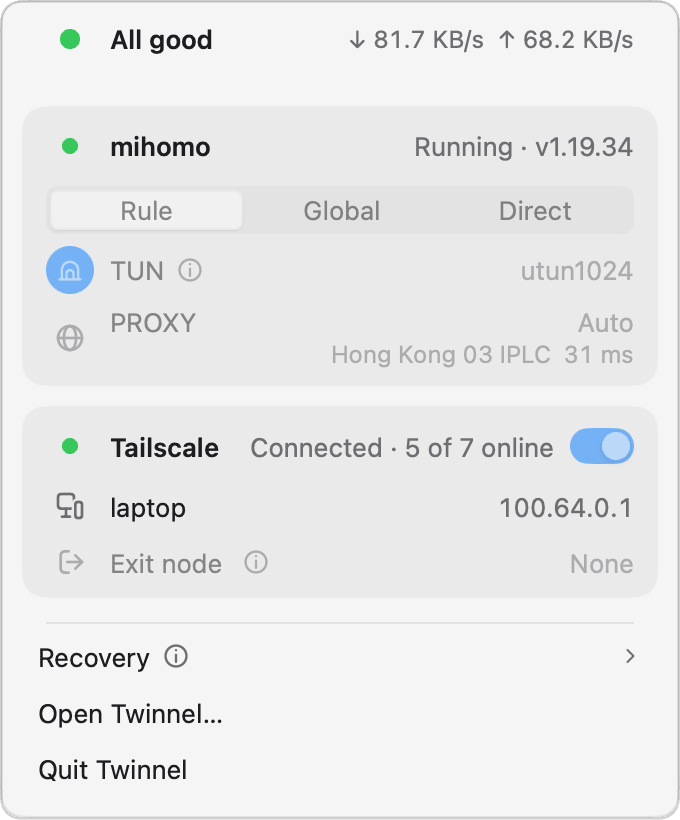

# Twinnel

[简体中文](README.zh-CN.md)

Twinnel runs the **official** [mihomo](https://github.com/MetaCubeX/mihomo) core and [Tailscale](https://tailscale.com) side by side on a desktop, and keeps checking that they still coexist: tailnet traffic goes to Tailscale, everything else goes through mihomo's rules, and DNS answers each name from the right place.

It is a manager for the cores you already trust. It is **not** another Clash client:

- It does not bundle or patch mihomo or Tailscale. It uses the official binaries: ones already installed, or mihomo releases it downloads from GitHub and verifies.
- Both run as system services (LaunchDaemons on macOS, systemd units on Linux). The app is only a control panel: if it quits or crashes, your network keeps working.
- **Neither core takes the system VPN slot.** mihomo uses its own TUN, the open-source `tailscaled` uses its own tun device, and Twinnel generates the settings that make them coexist (route exclusions, DIRECT rules for Tailscale, MagicDNS routing) and verifies them with health checks.
- Your subscription stays read-only. Local changes (ports, DNS, your own rules, the Tailscale coexistence settings) are override layers composed on top of it, so a subscription update never loses them.

> **Status: early development.** macOS (arm64) is the first platform. On Linux the CLI, the health checks, the takeover planner and the helper (with systemd units) are wired up but have only been tested with fixtures, not on a real Linux host yet. Windows builds but has no platform layer. Interfaces and file formats may change.

## Screenshots

<picture>
  <source media="(prefers-color-scheme: dark)" srcset="docs/images/en/overview-dark.png">
  
</picture>

| | |
|---|---|
| <br>Proxy groups, with delays | <br>Tailscale devices |
| <br>Coexistence health checks | <br>A warning, with its evidence and fix |
| <br>Override layers: a pending change, previewed | <br>History, compared with the current config |
| <br>Local agents over MCP | <br>The menu bar panel |

The menu bar icon is monochrome; its states differ by shape (all OK, warning, error, unknown, Tailscale down, direct/global mode, no helper):


All screenshots use synthetic data (`scripts/readme-shots.sh`).

## What works today

| Area | State |
|---|---|
| `twinnel doctor`: 12 coexistence health checks, text / Markdown / JSON | macOS, Linux |
| `twinnel takeover plan`: read a hand-made mihomo + Tailscale setup and derive override layers that reproduce it, proven with `mihomo -t` and a semantic diff | macOS, Linux (read-only) |
| Adopt through the helper (`twinnel takeover plan --via-helper`, `twinnel helper adopt`): exact backup, import, apply, health before/after, automatic restore; `twinnel helper secure-controller`; `twinnel helper harden`: move the adopted mihomo to the managed kernel and a root-owned config dir in one restart. Procedure: [docs/runbook-adopt-macos.md](docs/runbook-adopt-macos.md) | macOS. Rehearsed on a copy of a real setup with a non-root helper (dry run for launchctl); not yet run as root on the real one |
| `twinnel compose`: subscription + override layers → config, validated with `mihomo -t` | all |
| Root helper (`twinnel-helper`): compose → validate → back up → write → hot reload → verify, with automatic rollback; subscriptions, layers, history, mihomo kernel download / switch / rollback; geo databases and the external dashboard, verified against published digests | macOS, Linux |
| Health checks inside the helper: on a timer, after applies and service operations, and on network changes (macOS); `twinnel helper health` | macOS, Linux (no network-change trigger on Linux yet) |
| Service control over RPC: start / stop / restart mihomo and tailscaled, install / uninstall the mihomo service | macOS (launchd), Linux (systemd); without root the helper only reports the plan |
| `twinnel helper install` / `uninstall` / `upgrade` / `restart`: prints the plan (uninstall: what goes and what stays; `--purge` also deletes Twinnel's data), then runs it as root. Uninstall never leaves mihomo without its service: after `harden` it moves mihomo back first (`--restore-mihomo`) | macOS: one administrator password dialog; Linux: run it with `sudo` (`--dry-run` needs no root). Not yet run on a real machine. |
| Menu bar app: monochrome status icon whose states differ by shape only (badge, broken ring, glyph), and a panel; main window with overview (the exit node's delay and, on request, the egress IP), proxy groups, Tailscale devices, health, logs, settings (login item, Dock icon, language: English or Chinese, local agents over MCP), and, through the helper, subscriptions and overrides, history, kernels, takeover; a first-run view while the helper is not installed | macOS; a control is enabled when what it acts on can act (mihomo's controller, Tailscale's LocalAPI, the helper); `TWINNEL_READ_ONLY=1` turns every write off for development and test runs |
| Secrets (controller secret, subscription URLs) | macOS: System keychain when the helper runs as root; Linux and development helpers: a 0600 `secrets.json` in the state dir (Secret Service later) |

## Install

Download `Twinnel_<version>_macos_universal.dmg` (macOS 15+, Apple silicon and Intel) or a Linux `.tar.gz` from [Releases](https://github.com/l3ony2k/twinnel/releases). Builds are not notarized, so the first launch on macOS needs one extra step (System Settings → Privacy & Security → Open Anyway, or `xattr -dr com.apple.quarantine /Applications/Twinnel.app`). Step by step, and for Linux: [docs/install.md](docs/install.md#english).

## Install from source

You need Go (the version in `go.mod`). No cgo, no other toolchain.

```sh
git clone https://github.com/l3ony2k/twinnel && cd twinnel
go build -o bin/twinnel ./cmd/cli          # CLI
go build -o bin/twinnel-helper ./cmd/helper  # root helper daemon
TWINNEL_READ_ONLY=1 go run ./cmd/app        # menu bar app (macOS), development run, read-only
```

Release archives (CLI + helper for macOS and Linux, plus `Twinnel.app` and a disk image when built on a Mac) come from:

```sh
scripts/build-release.sh            # into dist/, with SHA256SUMS
scripts/build-release.sh --no-app   # CLI and helper only (any host)
```

The `.app` and the CLI and helper inside it are signed ad hoc (`SIGN_IDENTITY` and `NOTARY_PROFILE` switch to a Developer ID signature and notarization), not notarized. A copy you build yourself is not quarantined, so it opens directly; a downloaded one has to be allowed once ([docs/install.md](docs/install.md#english)). Tagging `v*` builds all of this in GitHub Actions and creates a draft release ([docs/release.md](docs/release.md)).

### Daily use and development side by side

- **Coming from duet** (the name until 2026-11-27): `scripts/install-local.sh` or 设置 → 后台助手 → 更新 moves the old install over, data included; see [docs/runbook-adopt-macos.md](docs/runbook-adopt-macos.md#migrating-from-duet). `DUET_*` environment variables still work for one release.
- **Daily:** `scripts/install-local.sh` builds the release, quits the running `/Applications/Twinnel.app`, keeps a backup of it (`~/Library/Application Support/twinnel/backups`, newest 3), installs the new one, and runs `twinnel helper upgrade` only when the bundled helper differs from the installed one (one password prompt). This copy and the installed helper are the only ones with write access to the live system. 设置 → 后台助手 in the app shows the helper's version, updates, restarts or uninstalls it; 设置 → 通用 → 登录时打开 starts the app at login (packaged app only).
- **Development:** `go run ./cmd/app` against a development helper on a temp socket and a fake controller (`TWINNEL_SOCKET`, `TWINNEL_CONTROLLER`, see CONTRIBUTING), or read-only against the live setup (`TWINNEL_READ_ONLY=1`; screenshot runs default to it). A development build never asks for a helper update.

## CLI tour

Everything below except the helper commands is read-only.

```sh
twinnel doctor                      # the helper runs the health checks (the app's view); --local runs them here
twinnel doctor --markdown           # a report to paste into an issue (it shows tailnet names: review it first)
twinnel doctor --only magicdns,system-dns --json
twinnel doctor --egress             # opt-in: one HTTPS request direct and one through mihomo, compared

twinnel takeover plan --out ./plan  # find the running services, pick the subscription the live config
                                 # came from, write layers + composed config + semantic diff to ./plan

twinnel compose --sub sub.yaml --base base.yaml --layer my-rules.yaml \
  --tailnet-from-status --leak-guard Google,Meta \
  --validate /path/to/mihomo -o config.yaml

twinnel status                      # mihomo + Tailscale snapshot (what the menu bar shows)
twinnel version                     # Twinnel, helper, mihomo and Tailscale versions (read-only)
```

The helper commands talk to `twinnel-helper` over its Unix socket (`$TWINNEL_SOCKET`, default `/var/run/twinnel/helper.sock`):

```sh
twinnel helper status
twinnel helper install --dry-run    # print the service definition and every step; changes nothing
twinnel helper install              # macOS: asks for an administrator password; Linux: sudo twinnel helper install
twinnel helper upgrade [--check]    # replace the installed helper with the one next to Twinnel when it differs (no downgrade without --force)
twinnel helper restart              # restart only the helper
twinnel helper uninstall [--purge]  # lists what goes and what stays first; --purge also deletes settings, subscriptions, layers, history, keychain items
twinnel helper health [--run]       # the helper's last health report, or run the checks now
twinnel helper egress [--json]      # run the egress test once (two HTTPS GETs to an IP-echo address)
twinnel sub put main --url ...      # subscriptions: list | put | refresh | activate | rm
twinnel layer put rules rules.yaml  # override layers: list | get | put | rm | enable | disable | order
twinnel compose --preview           # compose and validate in the helper, no write
twinnel compose --apply             # validate, back up, write, reload, verify (rolls back on failure)
twinnel history                     # composed configs; twinnel history rollback ID
twinnel kernel check                # mihomo releases: list | check | install | rollback
twinnel geo status                  # geo databases: status | check | update [--proxy subscription] | auto weekly|off
twinnel dashboard install           # web dashboard: status | check | install | update | open
twinnel service restart mihomo      # services: status | start | stop | restart (mihomo, tailscaled) | install | uninstall (mihomo)
twinnel settings                    # leak guard, coexist, tailnet resolver, history size, kernel channel, auto-apply
twinnel tailnet refresh             # re-read the peers now (the helper also polls every 60 s)
twinnel events --follow
```

Taking over a hand-made setup (step by step in [docs/runbook-adopt-macos.md](docs/runbook-adopt-macos.md)):

```sh
twinnel takeover plan --via-helper  # the helper makes the plan and keeps it; prints the plan id
twinnel helper plans [PLAN_ID]      # list or show kept plans
twinnel helper adopt PLAN_ID        # back up, import, apply, compare health; restores the backup if worse
twinnel helper secure-controller    # set a controller secret (active after mihomo's next start)
twinnel helper harden plan          # macOS: what moving to the managed kernel and a root-owned dir would do
twinnel helper harden apply         # one restart of mihomo, a few seconds offline
```

Commands that ask `Proceed? [y/N]` need `--yes` when stdin is not a terminal.

AI agents (Claude Code, Codex, Cursor, …) can read and, within limits you set, operate Twinnel over MCP (`twinnel mcp`): see [docs/agents.md](docs/agents.md).

## Health checks

`tailnet-route`, `tun-route-exclude`, `tailscale-direct-rules`, `magicdns`, `peer-short-names`, `tailnet-resolver-binding`, `fake-ip-filter-mode`, `system-dns`, `vpn-conflict`, `leak-guard`, `leak-guard-egress` (opt-in), `controller-security`. Each reports a status, the evidence it read, and a fix hint. See [docs/architecture.md](docs/architecture.md#health-checks) for what each one checks.

## Safety model

- Only the helper runs as root, and every change to the system, the mihomo config or a binary goes through it. Its RPC methods are a fixed allowlist; none of them accepts a file path or a command from the client. Paths live in the helper's root-owned settings file, the only URLs a client can send are subscription URLs, and a kernel install takes only a release channel.
- The socket is mode 0660 for one group: `admin` on macOS; on Linux `sudo`, else `wheel`, else a `twinnel` group that the install creates. Each request's peer uid and groups come from the kernel's peer credentials. (On Linux these carry only the primary group for now, so a member of `sudo`/`wheel` whose primary group is different is refused; use root until that is fixed.)
- Before a config is written it must pass the official `mihomo -t`. The old file is backed up first, and if the reload or the post-reload check fails, the old config is restored.
- Mihomo kernels come only from the official GitHub releases, and their SHA-256 digests are checked before switching. The previous version is kept for rollback. Geo databases and the dashboard from GitHub releases are checked against the published digest too, and a geo update that `mihomo -t` rejects is rolled back.
- The controller secret and subscription URLs never go into history, logs or error messages. The egress test masks the public IPs it reports; other evidence in a report (tailnet names, peer endpoints) is shown as read, so look over a report before sharing it. The repository contains no personal data; `scripts/check-no-personal-data.sh` checks that against a pattern file kept outside the tree.

Details: [docs/architecture.md](docs/architecture.md). Reporting a vulnerability: [SECURITY.md](SECURITY.md).

## Contributing

See [CONTRIBUTING.md](CONTRIBUTING.md). The product requirements and technical design are in `docs/requirements.md` and `docs/tech.md` (Chinese).

## License

MIT, see [LICENSE](LICENSE). Bundled icons: [THIRD_PARTY_NOTICES.md](THIRD_PARTY_NOTICES.md).
