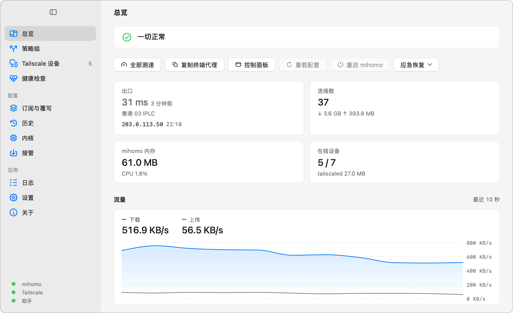
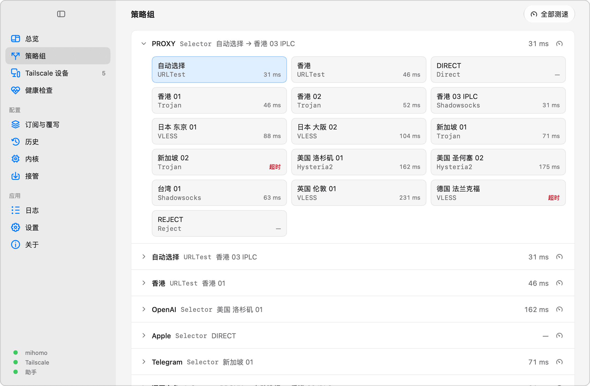
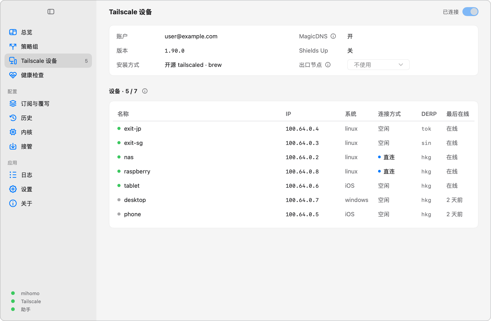
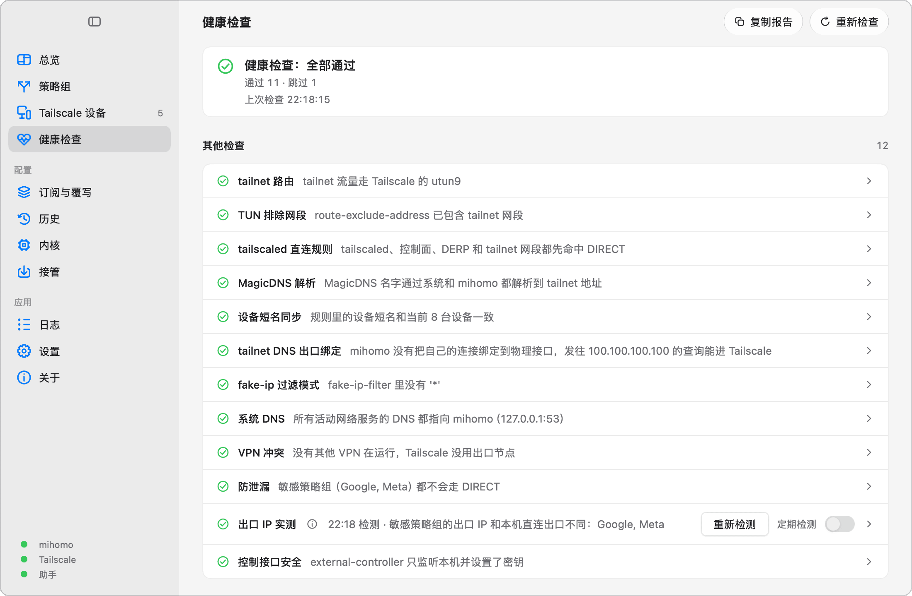
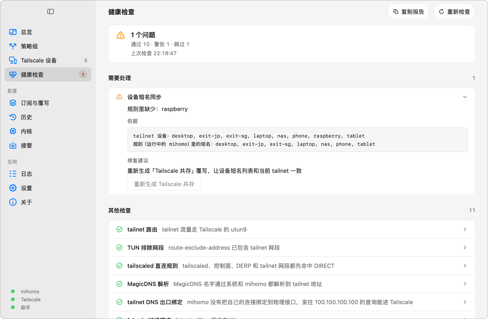
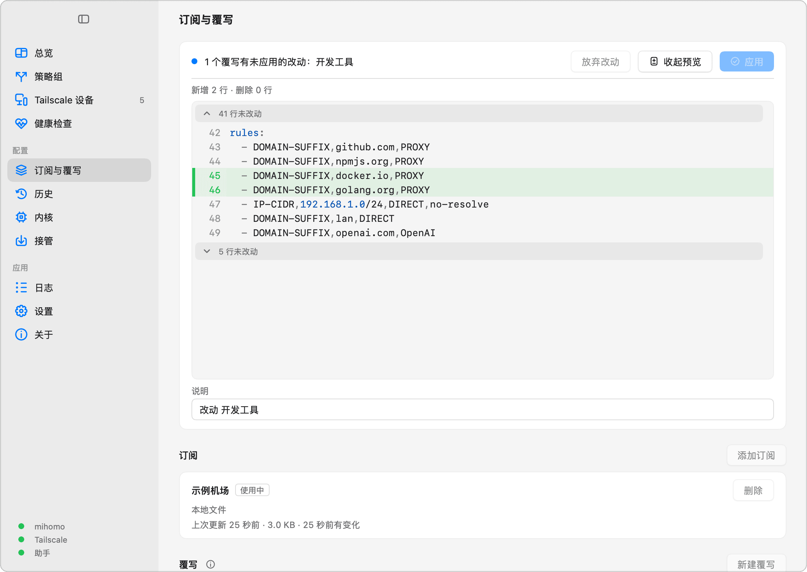
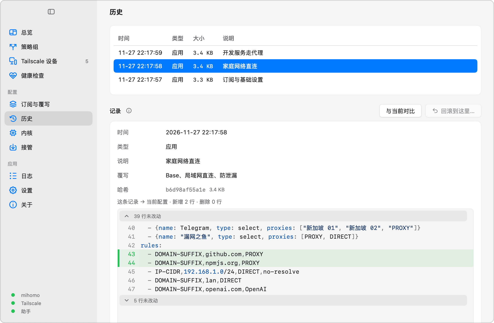
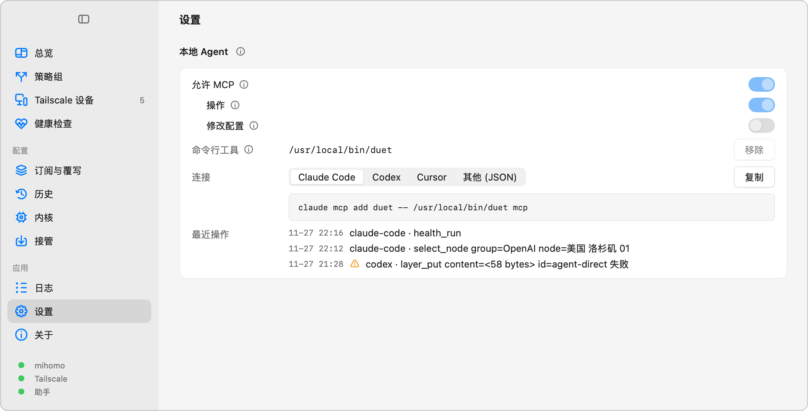
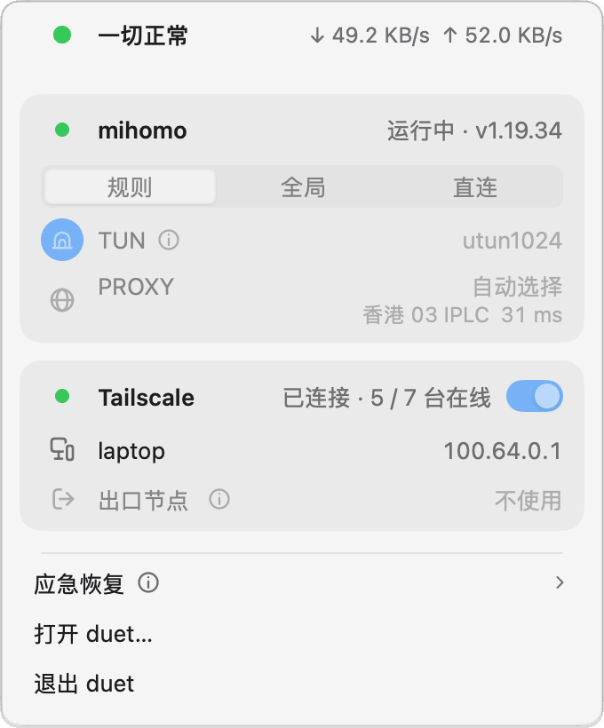

# duet

[English](README.md)

duet 在桌面上同时跑**官方的** [mihomo](https://github.com/MetaCubeX/mihomo) 内核和 [Tailscale](https://tailscale.com)，并持续检查两者是否还能和平共处：tailnet 流量交给 Tailscale，其余流量按 mihomo 的规则走，每个域名都由该负责的一方来解析。

它管理的是你本来就信任的官方内核，**不是**又一个 Clash 客户端：

- 不内置、不魔改 mihomo 或 Tailscale。用的都是官方二进制：机器上已经装好的，或者从 GitHub 下载并校验过的 mihomo 正式发布版。
- 两个内核都以系统服务运行（macOS 上是 LaunchDaemon，Linux 上是 systemd unit）。App 只是控制面板，退出或崩溃都不影响网络。
- **谁都不占系统 VPN 通道。** mihomo 用自己的 TUN，开源版 `tailscaled` 用自己的 tun 设备；duet 负责生成让两者共存的设置（排除 tailnet 网段、Tailscale 相关流量直连、MagicDNS 的解析路径），并用健康检查持续核对。
- 订阅保持只读。本机的改动（端口、DNS、自己的规则、Tailscale 共存设置）都写成覆写层，叠加在订阅之上，订阅更新时不会丢。

> **现状：早期开发中。** 首先支持 macOS（arm64）。Linux 上的命令行、健康检查、接管分析和 helper（含 systemd unit）都已接好，但只用测试数据验证过，还没在真实的 Linux 机器上跑过。Windows 能编译，但还没有平台层。接口和文件格式都可能变。

## 截图

<picture>
  <source media="(prefers-color-scheme: dark)" srcset="docs/images/zh/overview-dark.png">
  
</picture>

| | |
|---|---|
| <br>策略组与延迟 | <br>Tailscale 设备 |
| <br>共存健康检查 | <br>警告项：证据和修复建议 |
| <br>覆写层：预览未应用的改动 | <br>历史版本，和当前配置对比 |
| <br>通过 MCP 接入本地 Agent | <br>菜单栏面板 |

菜单栏图标是单色的，不同状态只靠形状区分（正常、警告、错误、未知、Tailscale 断开、直连/全局模式、没有后台助手）：


截图里都是虚构的数据（`scripts/readme-shots.sh`）。

## 目前能做什么

| 功能 | 状态 |
|---|---|
| `duet doctor`：12 项共存健康检查，输出纯文本 / Markdown / JSON | macOS、Linux |
| `duet takeover plan`：读取手工搭好的 mihomo + Tailscale，推导出能还原现有配置的覆写层，并用 `mihomo -t` 和语义 diff 证明等价 | macOS、Linux（只读） |
| 经 helper 接管（`duet takeover plan --via-helper`、`duet helper adopt`）：精确备份、导入、应用、前后健康检查对比、变差自动还原；`duet helper secure-controller`；`duet helper harden`：一次重启把接管的 mihomo 换到托管内核和 root 所有的配置目录。步骤见 [docs/runbook-adopt-macos.md](docs/runbook-adopt-macos.md)（英文） | macOS。已在真实配置的副本上用非 root helper 演练过（launchctl 只做 dry run），还没在真机上以 root 跑过 |
| `duet compose`：订阅 + 覆写层 → 配置，用 `mihomo -t` 校验 | 全平台 |
| root helper（`duet-helper`）：合成 → 校验 → 备份 → 写入 → 热重载 → 验证，失败自动回滚；订阅、覆写层、历史版本，mihomo 内核下载 / 切换 / 回滚；geo 数据库和外部面板（按发布页公布的摘要校验） | macOS、Linux |
| helper 内置健康检查：定时跑，配置应用和服务操作之后跑，网络变化时跑（仅 macOS）；`duet helper health` | macOS、Linux（Linux 还没有网络变化触发） |
| 通过 RPC 管理服务：mihomo 和 tailscaled 的启动 / 停止 / 重启，mihomo 服务的安装 / 卸载 | macOS（launchd）、Linux（systemd）；helper 不是 root 时只返回计划，不执行 |
| `duet helper install` / `uninstall` / `upgrade` / `restart`：先打印计划（卸载会列出移除和保留的内容，`--purge` 同时删除 duet 的数据），再以 root 执行。卸载不会让 mihomo 失去服务：`harden` 之后会先把 mihomo 切回原来的服务（`--restore-mihomo`） | macOS：弹一次管理员密码框；Linux：用 `sudo` 运行（`--dry-run` 不需要 root）。还没在真机上实际安装过。 |
| 菜单栏 App：单色状态图标（不同状态只靠形状区分：角标、断开的环、不同符号）和弹出面板；主窗口有总览（出口节点的延迟，按需检测出口 IP）、策略组、Tailscale 设备、健康检查、日志、设置（登录时打开、程序坞图标、界面语言：中文或英文、通过 MCP 接入本地 Agent），以及经 helper 的订阅与覆写、历史、内核、接管；helper 未安装时显示首次使用页 | macOS；控件在它作用的对象能操作时可用（mihomo 控制接口、Tailscale LocalAPI、后台助手）；开发和测试运行用 `DUET_READ_ONLY=1` 关掉所有写操作 |
| 凭证（controller secret、订阅地址） | macOS：helper 以 root 运行时存在系统钥匙串（System keychain）；Linux 和开发用的 helper：状态目录里一个 0600 权限的 `secrets.json`（以后接 Secret Service） |

## 从源码安装

需要 Go（版本见 `go.mod`），不需要 cgo，也不需要其他工具链。

```sh
git clone https://github.com/l3ony2k/duet && cd duet
go build -o bin/duet ./cmd/cli            # 命令行
go build -o bin/duet-helper ./cmd/helper  # root helper 守护进程
DUET_READ_ONLY=1 go run ./cmd/app         # 菜单栏 App（macOS），开发模式只读运行
```

发布包（macOS 和 Linux 的 CLI + helper；在 Mac 上构建时另有 `duet.app` 和磁盘映像）用这个脚本生成：

```sh
scripts/build-release.sh            # 输出到 dist/，附 SHA256SUMS
scripts/build-release.sh --no-app   # 只构建 CLI 和 helper（任何系统都能跑）
```

`.app` 以及其中的 CLI 和 helper 都是 ad hoc 签名（设置 `SIGN_IDENTITY` 和 `NOTARY_PROFILE` 可换成 Developer ID 签名并公证），没有公证。自己构建的副本没有隔离标记，可以直接打开；下载来的第一次要右键选"打开"。

### 日常使用与开发并存

- **日常：** `scripts/install-local.sh` 构建发布版，退出正在运行的 `/Applications/duet.app`，把旧版备份到 `~/Library/Application Support/duet/backups`（保留最新 3 个），装上新版；只有内置的 helper 和已安装的不同时才运行 `duet helper upgrade`（输一次密码）。只有这份 app 和已安装的 helper 能改动真实系统。App 的 设置 → 后台助手 显示 helper 版本，可以更新、重启、卸载；设置 → 通用 → 登录时打开 让 app 随登录启动（仅打包版）。
- **开发：** `go run ./cmd/app` 连临时 socket 上的开发 helper 和假的控制接口（`DUET_SOCKET`、`DUET_CONTROLLER`，见 CONTRIBUTING），或只读地连真实环境（`DUET_READ_ONLY=1`；截图运行默认如此）。开发构建不会提示更新 helper。

## 命令行速览

除了 helper 相关的命令，下面的都是只读的。

```sh
duet doctor                      # 对当前机器跑健康检查
duet doctor --markdown           # 生成可以贴进 issue 的报告（里面有 tailnet 设备名，贴之前看一眼）
duet doctor --only magicdns,system-dns --json
duet doctor --egress             # 可选：直连和经 mihomo 各发一次 HTTPS 请求，对比出口

duet takeover plan --out ./plan  # 找到正在运行的服务，判断现有配置来自哪份订阅，
                                 # 把覆写层、合成结果和语义 diff 写进 ./plan

duet compose --sub sub.yaml --base base.yaml --layer my-rules.yaml \
  --tailnet-from-status --leak-guard Google,Meta \
  --validate /path/to/mihomo -o config.yaml

duet status                      # mihomo + Tailscale 状态快照（菜单栏显示的就是这些）
duet version                     # duet、helper、mihomo、Tailscale 的版本（只读）
```

helper 相关的命令通过 Unix socket 和 `duet-helper` 通信（`$DUET_SOCKET`，默认 `/var/run/duet/helper.sock`）：

```sh
duet helper status
duet helper install --dry-run    # 打印服务定义和每一步操作，不做任何改动
duet helper install              # macOS 会要管理员密码；Linux 用 sudo duet helper install
duet helper upgrade [--check]    # 内置 helper 与已安装的不同时替换（不加 --force 不降级）
duet helper restart              # 只重启 helper
duet helper uninstall [--purge]  # 先列出移除和保留的内容；--purge 同时删除设置、订阅、覆写、历史和钥匙串项目
duet helper health [--run]       # helper 最近一次健康检查报告，或者立刻重跑
duet sub put main --url ...      # 订阅：list | put | refresh | activate | rm
duet layer put rules rules.yaml  # 覆写层：list | get | put | rm | enable | disable | order
duet compose --preview           # 在 helper 里合成并校验，不写入
duet compose --apply             # 校验、备份、写入、重载、验证（失败自动回滚）
duet history                     # 合成历史；duet history rollback ID 回滚
duet kernel check                # mihomo 内核：list | check | install | rollback
duet kernel geo check            # geo 数据库：check | update；面板用 duet kernel ui check|update
duet service restart mihomo      # 服务：status | start | stop | restart（mihomo、tailscaled）| install | uninstall（仅 mihomo）
duet settings                    # 防泄漏组、共存开关、tailnet 解析器、历史条数、内核通道、自动应用
duet tailnet refresh             # 立刻重读 tailnet 设备（helper 也会每 60 秒查一次）
duet events --follow
```

接管手工搭好的环境（详细步骤见 [docs/runbook-adopt-macos.md](docs/runbook-adopt-macos.md)）：

```sh
duet takeover plan --via-helper  # 由 helper 生成并保存计划，输出计划 ID
duet helper plans [PLAN_ID]      # 列出或查看已保存的计划
duet helper adopt PLAN_ID        # 备份、导入、应用、对比健康检查；变差就还原备份
duet helper secure-controller    # 设置 controller secret（mihomo 下次启动后生效）
duet helper harden plan          # macOS：看换到托管内核和 root 目录会做什么
duet helper harden apply         # mihomo 重启一次，断网几秒
```

会问 `Proceed? [y/N]` 的命令，在标准输入不是终端时要加 `--yes`。

本机的 AI Agent（Claude Code、Codex、Cursor 等）可以通过 MCP（`duet mcp`）查看 duet，并在你设定的范围内操作它：见 [docs/agents.md](docs/agents.md)（英文，附中文摘要）。

## 健康检查

`tailnet-route`、`tun-route-exclude`、`tailscale-direct-rules`、`magicdns`、`peer-short-names`、`tailnet-resolver-binding`、`fake-ip-filter-mode`、`system-dns`、`vpn-conflict`、`leak-guard`、`leak-guard-egress`（需手动开启）、`controller-security`。每一项都给出状态、读到的证据和修复建议。各项具体查什么，见 [docs/architecture.md](docs/architecture.md#health-checks)。

## 安全设计

- 只有 helper 以 root 运行，所有改动系统、mihomo 配置或二进制文件的操作都经过它。它的 RPC 方法是固定的白名单，没有一个接受客户端传来的文件路径或命令：路径只存在 helper 自己的 root 设置文件里；客户端能传的 URL 只有订阅地址；安装内核时只能指定发布通道。
- socket 权限是 0660，只开放给一个组：macOS 上是 `admin`；Linux 上依次选 `sudo`、`wheel`，都没有时由安装步骤新建 `duet` 组。每个请求都通过内核提供的对端凭证核对调用方的 uid 和组。（Linux 的对端凭证目前只带主组，所以主组不是 `sudo`/`wheel` 的成员会被拒绝；修好之前请用 root。）
- 配置写入前必须通过官方 `mihomo -t` 校验。写入前先备份旧文件；如果重载失败或重载后的检查不通过，会恢复旧配置。
- mihomo 内核只从官方 GitHub Release 下载，切换前校验 SHA-256，并保留上一个版本用于回滚。来自 GitHub Release 的 geo 数据库和面板同样按公布的摘要校验；更新后的 geo 文件过不了 `mihomo -t` 就自动回滚。
- controller secret 和订阅地址不会出现在历史版本、日志或错误信息里。出口测试会遮盖报告里的公网 IP；报告里的其他证据（tailnet 设备名、peer 的地址）按原样显示，分享之前请检查。仓库里没有任何个人数据，`scripts/check-no-personal-data.sh` 会用放在仓库外的特征列表检查这一点。

详见 [docs/architecture.md](docs/architecture.md)。报告安全问题请看 [SECURITY.md](SECURITY.md)。

## 参与开发

见 [CONTRIBUTING.md](CONTRIBUTING.md)。产品需求和技术方案在 `docs/requirements.md`、`docs/tech.md`。

## 许可证

MIT，见 [LICENSE](LICENSE)。内置图标的许可见 [THIRD_PARTY_NOTICES.md](THIRD_PARTY_NOTICES.md)。
